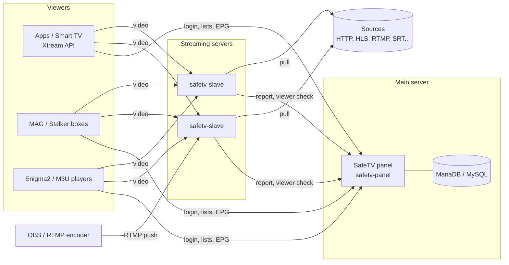

# SafeTV Panel

**SafeTV** is a self-hosted IPTV management panel for Linux: lines (clients), resellers, live channels, movies, series,
catch-up TV, MAG / Stalker boxes, Enigma2 and every app that speaks the Xtream Codes API, with its own lightweight
streaming servers (slaves), automatic source failover and an admin panel that works on the phone.

This repository contains **only the installer**. The compiled programs are published in [Releases](../../releases).
Every new install runs a **7-day trial**; after that it needs an official licence (see [Licence](#licence)).
Licences and support on Telegram: **[@Safetvpanel](https://t.me/Safetvpanel)**. 🎉 **30% off every licence until 15 January 2027** (holiday & launch offer).

```bash
curl -fsSL https://raw.githubusercontent.com/smart-ai-systems/SafeTv-Panel/main/install.sh | sudo bash -s -- --public-host YOUR.IP.OR.DOMAIN
```

---

## Contents

- [Features](#features)
- [Architecture](#architecture)
- [Requirements](#requirements)
- [Installation](#installation)
- [Slaves (streaming servers)](#slaves-streaming-servers)
- [Licence](#licence)
- [Security](#security)
- [Upgrading](#upgrading)

---

## Features

### Clients and resellers
- Lines with username / password, expiry, connection limit, bouquets, allowed / blocked countries, ASN, IP and user-agent rules.
- Mass edit, renew, code generation, playlist export, notes per client, live view of who is watching what.
- **Resellers** with credits, their own sub-resellers and clients, their own panel (works on the phone) and a credit log.
- Active codes and MAC lists for MAG / Stalker devices.
- Built-in protection: double-IP and restreamer detection, attack lists, login throttling, blocklists.

### Live TV
- **Several sources per channel with automatic failover**: when a source fails or stops, the next one takes over; bad sources are remembered.
- HTTP / HTTPS TS, **HLS** (`.m3u8`, served as HLS or joined into TS), RTMP / RTSP / SRT / UDP pull (remux, no re-encoding).
- **OBS / RTMP in**: stream a channel from OBS (or any RTMP encoder) straight to a slave, with a stream key per channel.
- On-demand channels: a source is opened only while someone watches.
- Optional transcoding profiles (ffmpeg), DRM (ClearKey / CENC) sources, custom headers and user agents per source.
- **Catch-up TV** (archive) on the main server or on a slave.
- EPG (XMLTV) sources, genres, categories, bouquets, logos, country badges.
- Provider scan: check whole playlists, see what is alive, import channels and streams with their logos.

### Movies and series
- VOD and series library with TMDB / OMDB metadata, posters, durations and subtitles.
- Import movies and series from a slave's folders; find & replace; mass edit.

### Apps and devices
- **Xtream Codes API** (`player_api.php`, `get.php`, `xmltv.php`): IPTV Smarters, TiviMate, XCIPTV, OTT Navigator and similar apps.
- **Stalker / MAG portal** (`/c`, `portal.php`): live, movies, series, EPG, favourites, several portal addresses.
- **Enigma2** bouquets and M3U / M3U Plus playlists.
- Correct UTF-8 everywhere: Albanian, Turkish, Arabic, Cyrillic... names show correctly in every app.

### Servers
- **Slaves**: one small program (`safetv-slave`) turns any Linux VPS into a streaming server, with load balancing, health checks and one-click Update / Restart from the panel.
- **Front servers**: a VPS with Caddy in front of the panel (your own domains and HTTPS); video never goes through it.
- **Mirror servers**: a standby copy of the main server (database, settings, data), refreshed every few minutes, with a one-command takeover.
- **Main 2**: a second main server that works at the same time on the same database.
- Extra listening ports, Cloudflare support, personal access URLs that hide the panel from scanners.

### Administration
- Admin and reseller panels for desktop and **mobile**.
- Several administrators with permissions, daily database backup, database export, logs (client activity, credits, database).
- Migration from another panel (clients, channels, movies, series).
- Extension API (`/api/v1`) and management API for your own tools.

---

## Architecture



- **Main server**: one program (`safetv-panel`) serves the admin and reseller panels, the player APIs, the Stalker portal, EPG and playlists,
  and decides for every viewer which server streams the channel. It can also stream by itself; slaves are optional.
- **Slaves**: `safetv-slave` (one file, no dependencies) connects to the main server, reports its load and sessions, checks every viewer
  with the main server and relays the channel from the source. One source connection feeds all viewers of a channel on that slave.
- **Database**: MariaDB / MySQL on the main server only; slaves need no database.
- **No transcoding by default**: video is passed through as it arrives (TS, HLS joined into TS, RTMP repackaged), so a small VPS can serve many viewers.

---

## Requirements

| | |
|---|---|
| System | Linux x86_64 with systemd (Debian, Ubuntu, RHEL family) |
| Main server | 2 CPU / 2 GB RAM to start; MariaDB or MySQL (the installer sets it up) |
| Slave | any small Linux VPS; no database, no Python needed |
| Optional | ffmpeg (transcoding, RTMP / RTSP / SRT pull, catch-up) |

---

## Installation

On the server itself:

```bash
curl -fsSL https://raw.githubusercontent.com/smart-ai-systems/SafeTv-Panel/main/install.sh | sudo bash -s -- --public-host YOUR.IP.OR.DOMAIN
```

On another server over SSH:

```bash
./install.sh --remote root@HOST [--ssh-port 22] [--ssh-key FILE] --public-host HOST
```

The installer downloads the latest release, verifies its SHA-256, installs MariaDB, creates the database, the settings and the systemd
service, and prints at the end:

- the panel address (`http://YOUR.IP.OR.DOMAIN:8081/ui/login`),
- the admin username and a **random** password,
- the server's **Hardware ID** (needed for the licence).

Options: `--version X.Y.Z`, `--no-db-install`, `--ffmpeg`, `--no-service`, `--no-start`, `--dry-run`, `--help`.

Default ports: **8081** for the panel, **8181** for streaming and the player APIs (both can be changed).

---

## Slaves (streaming servers)

1. In the panel open **Servers**, add a server and copy the install command shown there.
2. Run it on the new VPS. The slave connects to the main server and shows as online within seconds.
3. Later updates: press **Update** on the Servers page; the slave downloads the new version from your main server.

For **OBS / RTMP in**, open TCP port 1935 on that slave, then in **Channels > channel > OBS / RTMP in** pick the slave and switch it on.
In OBS choose the *Custom* service, enter the server address and stream key from the panel, and use H.264 + AAC with a keyframe interval of 2 s.

---

## Licence

> 🎉 **Holiday & launch offer: 30% off every licence until 15 January 2027.**

| Licence | Price | Offer price (-30%, until 15 Jan 2027) |
|---|---|---|
| 1 month | €79.99 | **€55.99** |
| 1 year | €649 | **€454.30** |
| Perpetual (lifetime) | €2,499 | **€1,749.30** |

| | Trial | Official licence |
|---|---|---|
| Duration | 7 days from the first start | 1 month, 1 year or perpetual |
| Clients | up to 100 | as licensed |
| Slaves | 1 | as licensed |
| Bound to | this server | this server's Hardware ID |

- The trial starts automatically on a fresh install; there is nothing to register.
- To get an official licence: in the panel open **License**, copy the **Hardware ID** and send it on Telegram to
  **[@Safetvpanel](https://t.me/Safetvpanel)**. You receive one licence line; paste it on the License page. No restart is needed.
- When the trial or the licence ends, the **panel pages are locked** until a valid licence is installed. **Streaming keeps working**,
  so viewers are not cut off.
- Re-installing or upgrading on the same server keeps the licence.

---

## Security

- Every install generates its own database and admin passwords; nothing is shared between installs.
- Releases contain only the compiled programs, the database schema, the systemd units and the installer: no source, no data, no keys.
  Each release ships a `SHA256SUMS` file, and the installer verifies the download.
- Running commands on slaves from the panel is off by default and must be enabled per slave.

---

## Upgrading

Run the same install command again. It replaces the programs and keeps the settings, the data, the database and the licence.
Slaves are upgraded from the panel (**Servers > Update**).
